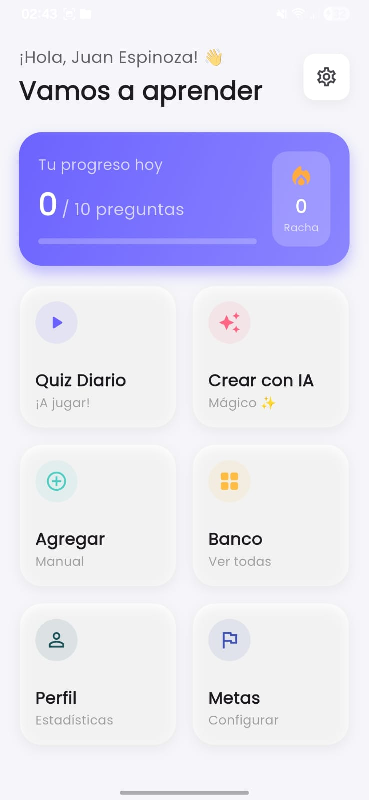
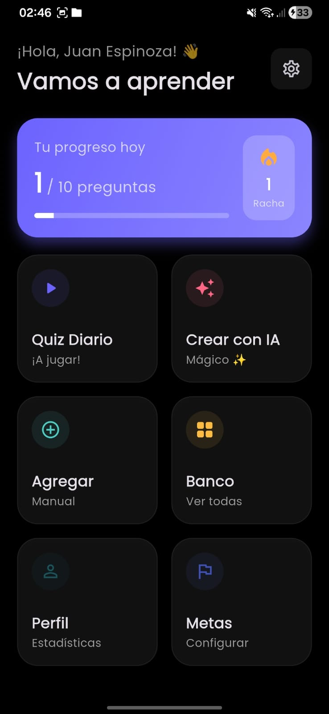
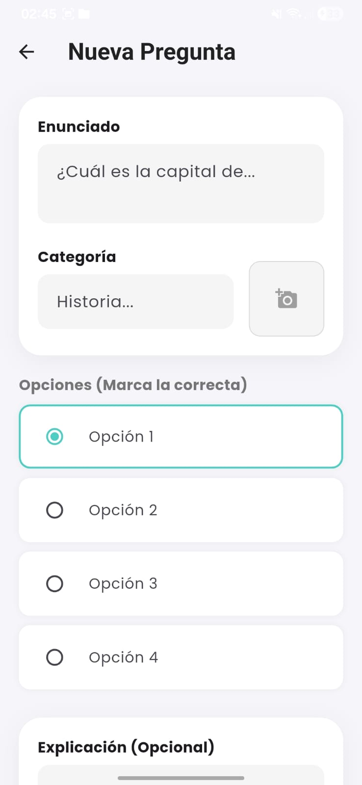
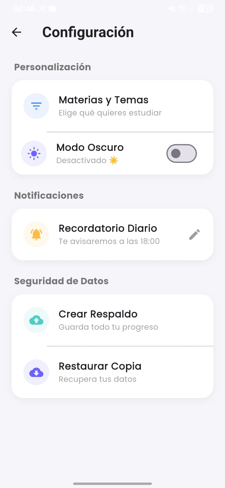

# 🧠 QuizDaily+

**App Android de microaprendizaje diario.** Cargás preguntas a mano o las generás con IA a partir de tus apuntes, y la app te propone un quiz corto cada día, con meta diaria, racha y estadísticas.


Proyecto personal. No está publicado en ninguna tienda.

<p>
  
  
  
  
</p>

---

## Funcionalidades

- **Quiz diario** con meta configurable (preguntas por día) y racha de días seguidos.
- **Repaso inteligente:** las preguntas que fallás aparecen más seguido hasta que las acertás.
- **Modo examen:** prioriza una materia hasta la fecha del parcial.
- **Generación con IA (Gemini):** a partir de texto, un PDF o una imagen genera 5 preguntas de opción múltiple con explicación. Se pueden revisar y editar antes de guardarlas.
- **Banco de preguntas** con búsqueda, filtro por materia y filtro de "difíciles". Carga manual con imagen opcional.
- **Estadísticas:** precisión global y por materia, gráfico de la semana y logros.
- **Recordatorio diario** con notificación local a la hora elegida.
- **Respaldo y restauración** en un archivo JSON que se puede compartir.
- **Modo claro y oscuro.**
- Todo se guarda en el teléfono con Hive: la app funciona sin conexión, salvo el generador con IA.

## Stack

| Área | Tecnología |
|---|---|
| App | Flutter 3.35+ / Dart 3.9 |
| Persistencia local | Hive + `hive_generator` (adapters generados con `build_runner`) |
| IA | Gemini 2.5 Flash con `google_generative_ai` |
| Notificaciones | `flutter_local_notifications`, `timezone`, `flutter_timezone` |
| UI | Material 3, `fl_chart`, `google_fonts` |
| Archivos | `file_picker`, `image_picker`, `share_plus`, `path_provider` |

## Arquitectura

```
lib/
├── main.dart                  # Arranque: Hive, cambio de día, notificaciones, tema y HomeScreen
├── models/                    # Question, UserProgress, DailyStats (+ adapters *.g.dart generados)
├── screens/                   # Una pantalla por archivo
├── services/
│   ├── storage_service.dart       # Abre las cajas de Hive (nombres en HiveBoxes) y maneja errores
│   ├── progress_service.dart      # Meta diaria, racha y cambio de día
│   ├── gemini_service.dart        # Prompt, esquema JSON y validación de la respuesta de la IA
│   ├── notification_service.dart  # Recordatorio diario en la zona horaria del dispositivo
│   ├── data_sync_service.dart     # Exporta el respaldo JSON
│   └── import_service.dart        # Importa respaldos (formato viejo y nuevo)
└── theme/app_colors.dart      # Paleta de colores
test/                          # Tests unitarios de los servicios
```

- **Screens:** widgets de Flutter. Leen las cajas de Hive directamente y se redibujan con `ValueListenableBuilder(box.listenable())`. No hay una capa de estado aparte (Provider, Riverpod, etc.).
- **Services:** la lógica que no depende de la UI (racha, validación de la IA, respaldos). Es la parte cubierta por tests.
- **Models + Hive:** tres cajas.
  - `questionsBox`: las preguntas (`Question`).
  - `progressBox`: un único `UserProgress` con meta, racha y preferencias.
  - `statsBox`: un `DailyStats` por día, con respondidas y acertadas.

  Los campos que se agregaron después de la primera versión tienen `defaultValue` para poder leer datos viejos. Si Hive no puede abrir una caja, la app no borra nada: muestra una pantalla para reintentar o restablecer solo esa caja, y antes guarda una copia de los archivos.

Después de cambiar un modelo, regenerar los adapters:

```bash
dart run build_runner build --delete-conflicting-outputs
```

## Cómo correrlo

Requisitos: Flutter 3.35 o superior (probado con 3.44) y un emulador o teléfono Android.

```bash
git clone https://github.com/JuanEspinoza8/app_quiz.git
cd app_quiz
flutter pub get
```

### API key de Gemini

La generación con IA usa una API key de [Google AI Studio](https://aistudio.google.com/apikey). La clave no está en el código: se pasa al compilar con `--dart-define`.

```bash
cp env.example.json env.json   # env.json está en .gitignore
# editar env.json y completar GEMINI_API_KEY
flutter run --dart-define-from-file=env.json
```

Sin la clave, la app funciona igual, pero el generador con IA muestra un error que avisa que falta configurarla.

> **Importante:** en una app cliente, cualquier valor que viaja en el APK (incluido un `--dart-define`) se puede extraer descompilándolo. `--dart-define` sirve para no subir la clave al repo, no para ocultarla. Por eso conviene restringirla en Google Cloud Console → *Credenciales*:
>
> - **Restricción de API:** solo *Generative Language API*. Funciona sin cambios en la app.
> - **Restricción de aplicación Android** (nombre de paquete + huella SHA-1 del certificado de firma). Google valida esta restricción con los headers `X-Android-Package` y `X-Android-Cert`, que el SDK de Dart no envía solo. La app los agrega si se define `ANDROID_CERT_SHA1` en `env.json` (y `ANDROID_PACKAGE` si cambia el `applicationId`):
>
>   ```json
>   { "GEMINI_API_KEY": "...", "ANDROID_CERT_SHA1": "AA:BB:CC:..." }
>   ```
>
>   La huella sale de `cd android && ./gradlew signingReport`. Sin estos valores, una clave restringida a Android responde 403.
>
> Ninguna de las dos impide que alguien con el APK reutilice la clave: la protección real es un backend propio (o Firebase App Check) entre la app y Gemini.

## Tests

```bash
flutter analyze
flutter test
```

Cubren `ProgressService` (cambio de día, racha consecutiva y rota, meta cumplida, historial diario), `ImportService` (respaldos en formato viejo y nuevo, duplicados) y la validación de las respuestas de Gemini. Hive corre en una carpeta temporal y la fecha se inyecta, así que los tests no dependen del reloj ni de un dispositivo.

## Limitaciones conocidas

- **Solo probada en Android.** Las carpetas de iOS, web y escritorio son las que genera Flutter y las notificaciones solo se configuran para Android.
- **La API key viaja en el APK.** No hay backend propio (ver la sección de la API key).
- **`google_generative_ai` está deprecado** por Google en favor de Firebase AI Logic. Migrar está pendiente.
- **No hay capa de estado ni de repositorio:** las pantallas acceden a Hive directamente.
- **No se pueden borrar preguntas** desde la app.
- **El cambio de día se calcula al abrir la app o el quiz.** Si la app queda en segundo plano de un día para otro, el inicio muestra el progreso del día anterior hasta entrar al quiz.
- **Imágenes:** se guarda la ruta del archivo que devuelve `image_picker`, que puede estar en la caché de la app. El respaldo JSON no incluye las imágenes.
- **No está lista para publicar:** el `applicationId` es `com.example.quiz_daily` y el build de release se firma con la clave de debug.
- Hay tests unitarios de los servicios, pero no tests de widgets.

## Autor

**Juan Espinoza** — [github.com/JuanEspinoza8](https://github.com/JuanEspinoza8)

Licencia [MIT](LICENSE).
