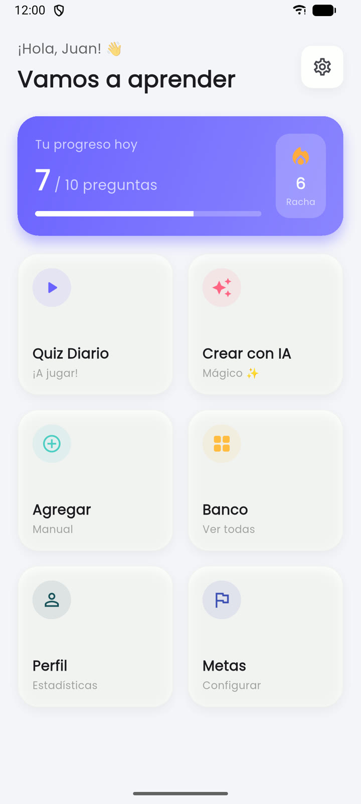
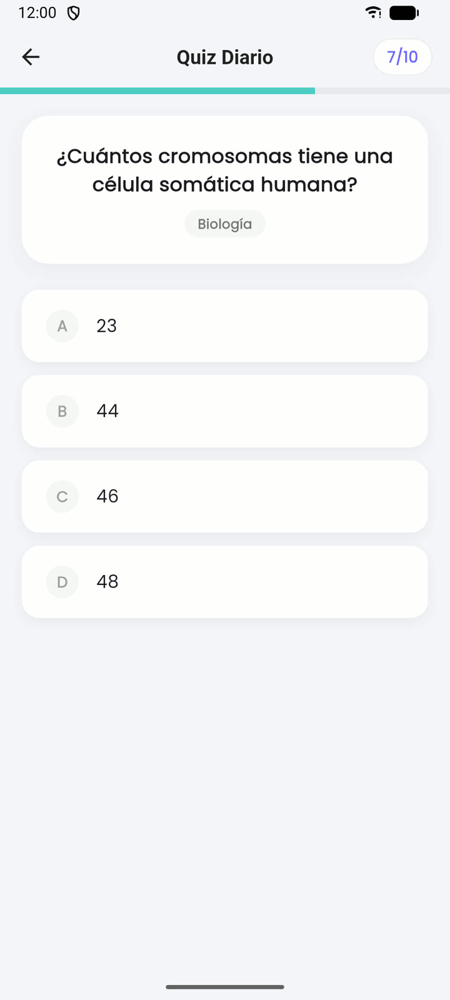
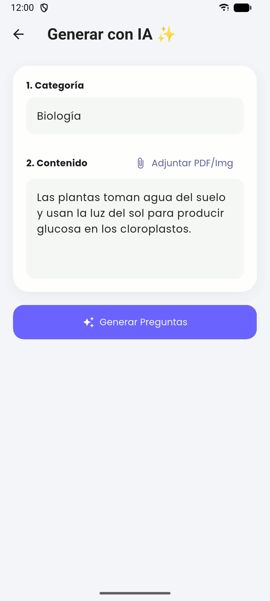
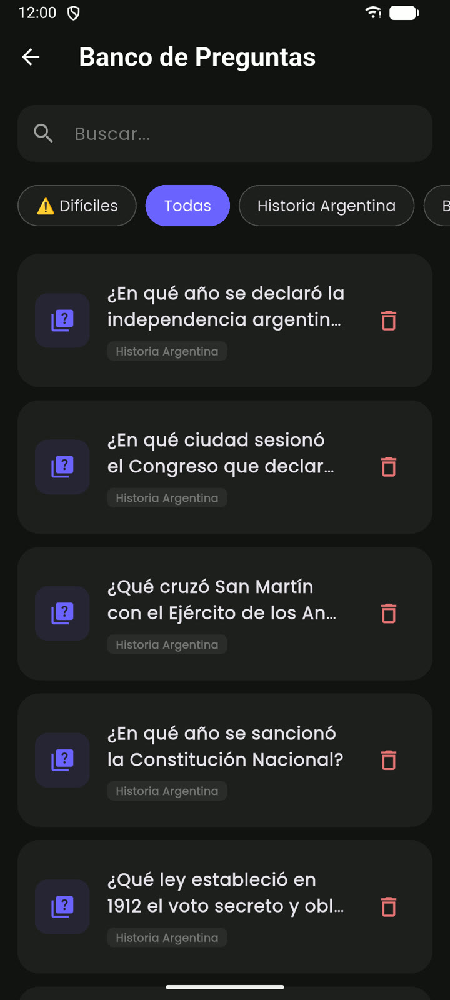
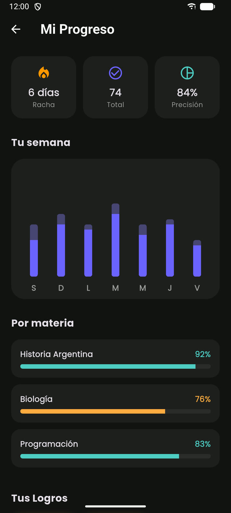
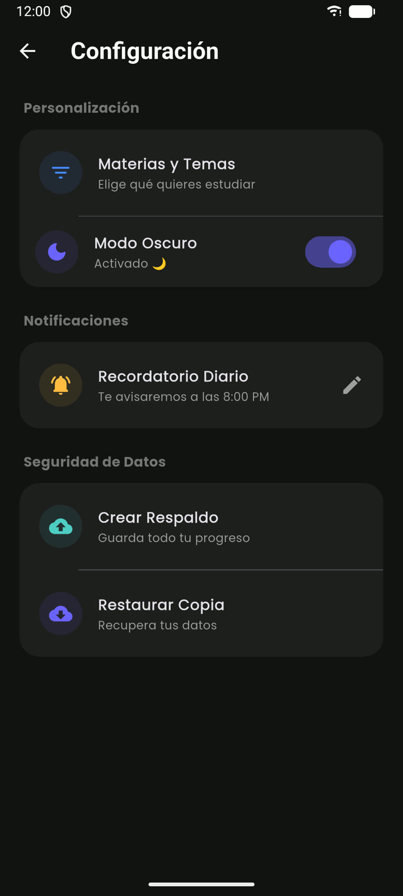

# 🧠 QuizDaily+

**App Android de microaprendizaje diario.** Cargás preguntas a mano o las generás con IA a partir de tus apuntes, y la app te propone un quiz corto cada día, con meta diaria, racha y estadísticas.


Proyecto personal. No está publicado en ninguna tienda.

| Inicio | Quiz diario | Generador con IA |
|:---:|:---:|:---:|
|  |  |  |
| **Banco de preguntas** (modo oscuro) | **Progreso** (modo oscuro) | **Configuración** (modo oscuro) |
|  |  |  |

<sub>Capturas de un emulador Android con datos de ejemplo.</sub>

---

## Funcionalidades

- **Quiz diario** con meta configurable (preguntas por día) y racha de días seguidos. Después de responder, la corrección y la explicación quedan en pantalla hasta tocar "Continuar".
- **Dos tipos de pregunta:**
  - **Opción múltiple** (de 2 a 6 opciones, que se muestran mezcladas), con imagen opcional.
  - **Relacionar con imágenes:** elementos a la izquierda (números, palabras o conceptos) e imágenes mezcladas a la derecha. Se unen arrastrando una línea con el dedo o el mouse, o tocando el elemento y después la imagen. Cada elemento tiene una sola pareja y cada imagen recibe una sola línea; se puede corregir antes de confirmar. Al confirmar se marca cada pareja como correcta o incorrecta y se muestra la correcta.
- **Repaso inteligente:** las preguntas que fallás aparecen más seguido hasta que las acertás, y nunca sale la misma dos veces seguidas.
- **Modo examen:** usa solo las preguntas de una materia; con fecha, se desactiva solo cuando pasa el examen.
- **Generación con IA (Gemini):** a partir de texto, un PDF o una imagen genera 5 preguntas de opción múltiple con explicación. Se pueden revisar, editar o descartar antes de guardarlas.
- **Banco de preguntas** con búsqueda (en enunciado, opciones y elementos), filtro por materia y filtro de "difíciles". Edición y borrado (con "Deshacer").
- **Estadísticas:** precisión global y por materia, gráfico de la semana y logros (los de racha usan la mejor racha).
- **Recordatorio diario** con notificación local a la hora elegida; no avisa los días en que la meta ya está cumplida.
- **Respaldo y restauración** en un `.zip` con las preguntas, las imágenes y el progreso. También restaura el `.json` de la versión anterior, y se puede elegir traer solo las preguntas.
- **Modo claro y oscuro.**
- Todo se guarda en el teléfono con Hive: la app funciona sin conexión, salvo el generador con IA.

## Stack

| Área | Tecnología |
|---|---|
| App | Flutter 3.35+ / Dart 3.9 |
| Persistencia local | Hive + `hive_generator` (adapters generados con `build_runner`); imágenes en la carpeta de documentos de la app |
| Estado | `provider` (repositorios como `ChangeNotifier`) |
| IA | Gemini Flash (alias `gemini-flash-latest`, con `gemini-flash-lite-latest` de respaldo) y `google_generative_ai` |
| Notificaciones | `flutter_local_notifications`, `timezone`, `flutter_timezone` |
| UI | Material 3, `fl_chart`, `google_fonts` |
| Archivos | `file_picker`, `image_picker`, `share_plus`, `path_provider`, `archive` (respaldo .zip) |
| Idioma | `flutter_localizations` (componentes de Flutter en español) |

## Arquitectura

```
lib/
├── main.dart                  # Arranque: abre Hive y las imágenes, crea los repositorios, programa los recordatorios
├── models/                    # Question, UserProgress, DailyStats (+ adapters *.g.dart generados)
├── data/
│   ├── question_repository.dart   # Preguntas: alta, edición, borrado/deshacer, respuestas, materias
│   └── progress_repository.dart   # Meta, racha, cambio de día, modo examen, preferencias e historial diario
├── logic/
│   ├── question_validator.dart    # Reglas de una pregunta jugable (editor, importación e IA)
│   └── matching.dart              # Relacionar: mezcla de las imágenes, conexiones y corrección
├── screens/                   # Una pantalla por archivo
├── services/
│   ├── storage_service.dart       # Abre las cajas de Hive (nombres en HiveBoxes) y maneja errores
│   ├── image_store.dart           # Copia las imágenes a la carpeta de la app y las resuelve por nombre
│   ├── gemini_service.dart        # Prompt, esquema JSON y validación de la respuesta de la IA
│   ├── notification_service.dart  # Recordatorios de los próximos 14 días en la zona horaria del dispositivo
│   ├── data_sync_service.dart     # Exporta el respaldo .zip (backup.json + imágenes)
│   └── import_service.dart        # Importa respaldos (.zip y .json viejo), valida antes de escribir
├── widgets/
│   ├── matching_board.dart        # Tablero de relacionar: arrastre, líneas y corrección
│   ├── question_image.dart        # Imagen de una pregunta por su referencia (con ícono si falta)
│   └── day_rollover_on_resume.dart  # Recalcula el día cuando la app vuelve del segundo plano
└── theme/app_colors.dart      # Paleta de colores
test/
├── data/                      # Repositorios (Hive en una carpeta temporal)
├── logic/                     # Validación y relacionar
├── models/                    # Lectura de preguntas guardadas por versiones anteriores
├── services/                  # Imágenes, respaldo, importación, recordatorios y Gemini
├── widgets/                   # Tablero de relacionar (touch, mouse, scroll)
└── screens/                   # Quiz, editor, banco, metas, perfil, IA y cambio de día
```

- **Screens:** widgets de Flutter. No tocan Hive: leen los repositorios con `context.watch` / `context.select` y escriben con `context.read`.
- **Data (repositorios):** son el único acceso a Hive y extienden `ChangeNotifier`. Escuchan su caja con `box.watch()`, así que cualquier cambio (una respuesta, una importación) redibuja las pantallas que lo usan. La lógica de racha y cambio de día vive en `ProgressRepository`.
- **Services:** integraciones y tareas puntuales: Gemini, notificaciones, respaldo y apertura de Hive.
- **Models + Hive:** tres cajas.
  - `questionsBox`: las preguntas (`Question`). El campo `type` dice si es de opción múltiple o de relacionar; en las de relacionar, `matchLeft[i]` va con `matchImages[i]` (el orden mezclado existe solo en pantalla). Las imágenes se guardan como archivos en `question_images/` y la pregunta guarda solo el nombre.
  - `progressBox`: un único `UserProgress` con meta, racha (y el último día en que se cumplió la meta), mejor racha y preferencias.
  - `statsBox`: un `DailyStats` por día, con respondidas y acertadas.

  Los campos que se agregaron después de la primera versión tienen `defaultValue` para poder leer datos viejos. Si Hive no puede abrir una caja, la app no borra nada: muestra una pantalla para reintentar o restablecer solo esa caja, y antes guarda una copia de los archivos.

Después de cambiar un modelo, regenerar los adapters:

```bash
dart run build_runner build --delete-conflicting-outputs
```

## Cómo correrlo

Requisitos: Flutter 3.35 o superior (probado con 3.44) y un emulador o teléfono Android.

```bash
git clone https://github.com/JuanEspinoza8/app_quiz.git
cd app_quiz
flutter pub get
```

### API key de Gemini

La generación con IA usa una API key de [Google AI Studio](https://aistudio.google.com/apikey). La clave no está en el código: se pasa al compilar con `--dart-define`.

```bash
cp env.example.json env.json   # env.json está en .gitignore
# editar env.json y completar GEMINI_API_KEY
flutter run --dart-define-from-file=env.json
```

Sin la clave, la app funciona igual, pero el generador con IA avisa que no está disponible en esta versión.

> **Importante:** en una app cliente, cualquier valor que viaja en el APK (incluido un `--dart-define`) se puede extraer descompilándolo. `--dart-define` sirve para no subir la clave al repo, no para ocultarla. Por eso conviene restringirla en Google Cloud Console → *Credenciales*:
>
> - **Restricción de API:** solo *Generative Language API*. Funciona sin cambios en la app.
> - **Restricción de aplicación Android** (nombre de paquete `io.github.juanespinoza8.quizdaily` + huella SHA-1 del certificado de firma). Google valida esta restricción con los headers `X-Android-Package` y `X-Android-Cert`, que el SDK de Dart no envía solo. La app los agrega si se define `ANDROID_CERT_SHA1` en `env.json` (y `ANDROID_PACKAGE` si cambia el `applicationId`):
>
>   ```json
>   { "GEMINI_API_KEY": "...", "ANDROID_CERT_SHA1": "AA:BB:CC:..." }
>   ```
>
>   La huella sale de `cd android && ./gradlew signingReport`. Sin estos valores, una clave restringida a Android responde 403.
>
> Ninguna de las dos impide que alguien con el APK reutilice la clave: la protección real es un backend propio (o Firebase App Check) entre la app y Gemini.

### APK de release

El build de release se firma con la clave que indique `android/key.properties` (no se sube al repo). Sin ese archivo se firma con la clave de debug: así cualquiera puede compilar el proyecto, pero **para entregar la app hay que usar siempre la misma clave**, porque Android no deja instalar una actualización firmada con otra.

```bash
keytool -genkey -v -keystore C:/ruta/fuera/del/repo/quizdaily-release.jks -keyalg RSA -keysize 2048 -validity 10000 -alias quizdaily
```

`android/key.properties`:

```properties
storePassword=...
keyPassword=...
keyAlias=quizdaily
storeFile=C:/ruta/fuera/del/repo/quizdaily-release.jks
```

Guardá una copia del `.jks` y de las contraseñas fuera de la computadora. Después:

```bash
flutter build apk --release --dart-define-from-file=env.json
```

`android/app/proguard-rules.pro` tiene las reglas que necesita `flutter_local_notifications` en release: sin ellas, R8 rompe Gson, los recordatorios no se programan y la app se cierra al actualizarla o al reiniciar el teléfono.

### Pasar los datos de la versión anterior

La versión anterior usaba otro `applicationId` (`com.example.quiz_daily`), así que Android instala esta como otra app. Los pasos para el usuario están en [docs/migracion-cliente.md](docs/migracion-cliente.md): respaldo en la vieja y "Restaurar Copia → Solo preguntas" en la nueva. Las imágenes de las preguntas viejas no pasan, porque estaban en la caché privada de la otra app.

## Tests

```bash
flutter analyze
flutter test
```

- **Repositorios:** cambio de día, racha (se suma al cumplir la meta, se corta si ayer no se cumplió, mejor racha, migración de datos viejos), modo examen, historial diario, preferencias, borrado y deshacer.
- **Lógica:** validación de preguntas; en relacionar, la mezcla nunca deja el orden original y la corrección no depende de la mezcla.
- **Servicios:** imágenes, respaldo `.zip` de ida y vuelta, importación (formato viejo y nuevo, respaldo de la versión anterior, ítems inválidos, archivo roto, "solo preguntas"), horarios de los recordatorios y validación de Gemini.
- **Widgets:** tablero de relacionar (arrastre con dedo y con mouse, dentro de una página con scroll, tocar y tocar, una imagen por elemento, corrección con el ejemplo del cliente), quiz (la última pregunta del día muestra la corrección, opciones mezcladas, sin repetir, modo examen, relacionar de punta a punta), editor, banco, metas, perfil, IA y cambio de día.

La fecha se inyecta en `ProgressRepository` y el azar en `DailyQuizScreen`, así que los tests no dependen del reloj ni de la suerte. Los unitarios usan Hive en una carpeta temporal; los de widgets, cajas en memoria y un `ImageStore` falso.

## Limitaciones conocidas

- **Solo probada en Android.** Las carpetas de iOS, web y escritorio son las que genera Flutter y las notificaciones solo se configuran para Android.
- **La API key viaja en el APK.** No hay backend propio (ver la sección de la API key).
- **`google_generative_ai` está deprecado** por Google en favor de Firebase AI Logic. Migrar está pendiente.
- **Fuente:** Poppins se descarga con `google_fonts` la primera vez que se abre la app. Sin conexión se usa la fuente del sistema.
- **Mouse:** el arrastre con mouse está cubierto por tests de widgets. En el emulador, `adb shell input mouse` no genera clics (ni siquiera en botones comunes), así que conviene probarlo con un mouse real conectado al teléfono.
- **Modelo de IA:** se usa el alias `gemini-flash-latest`, que Google va actualizando al Flash vigente. Un nombre fijo (`gemini-2.5-flash`) dejó de estar disponible para claves nuevas y la app instalada no se actualiza sola. Si Flash está saturado o retirado, se usa `gemini-flash-lite-latest`.
- **Recordatorios:** se programan para los próximos 14 días cada vez que se abre la app; si no se abre en dos semanas, dejan de llegar.
- **Cambio de `applicationId`:** pasó de `com.example.quiz_daily` a `io.github.juanespinoza8.quizdaily` (ver "Pasar los datos de la versión anterior").
- **Configuración y Onboarding** no tienen tests de widgets.

## Autor

**Juan Espinoza** — [github.com/JuanEspinoza8](https://github.com/JuanEspinoza8)

Licencia [MIT](LICENSE).
